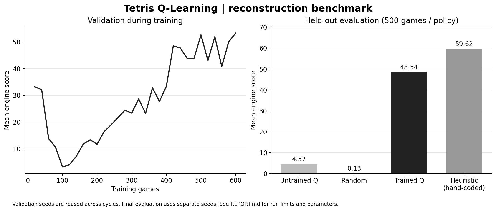

# Reconstruction run report

## Held-out game scores

| Policy | Games | Mean score | Sample SD | Mean pieces | Capped games |
| --- | ---: | ---: | ---: | ---: | ---: |
| q-untrained | 500 | 4.568 | 4.780 | 44.59 | 0 |
| random | 500 | 0.132 | 0.743 | 21.86 | 0 |
| q | 500 | 48.536 | 35.165 | 124.83 | 0 |
| heuristic | 500 | 59.618 | 34.883 | 172.13 | 0 |

All four policies used the same 500 piece-sequence seeds, **2000042–2000541**, with a limit of 1,000 placements per game. No game reached the cap. Scores come from `Game.getTotalScore()`, not shaped rewards. The learned policy improved over its untrained initialization and random play; the hand-coded baseline scored higher in this benchmark. This is one experiment, not a guarantee across engines or seeds.

## Training and checkpoint

- 30 cycles × 20 training games = **600 training games**, seeds 42–641.
- Fixed validation set: 20 games, seeds 1000042–1000061, reused after each cycle.
- Final cycle 30 achieved the run's highest validation mean, **53.25**.
- Final held-out evaluation was run after training; its seeds were not used for training or validation.
- No expert demonstrations, heuristic Q-value initialization or hand-coded policy were used to train the neural policy. The heuristic is a separate evaluation baseline.
- Network: 18 → 32 → 16 → 1, tanh hidden layers and linear output.
- Adam learning rate 0.001; gamma 0.95; replay capacity 10,000; up to 4,000 sampled transitions per cycle; 3 fitting epochs; minibatch 64; gradient clip ±5.
- Epsilon = 0.05 + 0.75 × exp(−training_games / 200).
- `loss_before` and `loss_after` in training.csv are **half-MSE**, as implemented by the supplied library; they are not game scores.
- Bundled checkpoint: `models/params.model` (copied from final `params/q.model`). SHA-256: `09a09f1aaa283df20a36e406c95bc44e9886b7ab7bfe3e5240e85479501a8bc5`.



## Reproduce

After setup and compilation:

```bash
bash scripts/run.sh train --seed 42 --cycles 30 --games-per-cycle 20 \
  --eval-games 20 --eval-seed 1000042 --max-pieces 1000 \
  --model params/q.model --csv results/training.csv

bash scripts/run.sh evaluate --model models/params.model --policy all \
  --seed 42 --eval-seed 2000042 --games 500 --max-pieces 1000 \
  --csv results/evaluation.csv

# The non-existent model path intentionally tests the untrained network.
bash scripts/run.sh smoke --model params/untrained-not-saved.model --policy q \
  --seed 42 --eval-seed 2000042 --games 500 --max-pieces 1000 \
  --csv results/untrained.csv
```

CSV companion JSON files contain the complete options. The released checkpoint can be evaluated immediately after dependency setup. To evaluate a newly trained model, change `--model` to its output path. Model-file loading requires matching network dimensions and feature order.

Plotting is optional and requires Python with matplotlib:

```bash
python -m pip install matplotlib==3.10.8
python scripts/plot_results.py
```

## Validation

`bash scripts/test.sh` passed **15 behavior tests**, covering board measurements, wells, one/two/four-line clears, eroded cells, immutability, top-out order, invalid inputs, feature normalization, exploration/reward, terminal versus truncated Bellman targets, seeded model initialization, checkpoint round-trip, optimizer learning and reproducible real games. The suite also checks repeatable tiny training, bounded replay and best-checkpoint selection. The synthetic regression half-MSE fell from 0.06199987 to 0.00000294.

An independent simulation audit also matched the engine board after all **3,844 moves** across 30 seeded games, including **953 line-clearing placements** and **28 top-outs**. The audit checked that hypothetical placements did not mutate the original board. Reproduce after `bash scripts/test.sh` with `java -Djava.awt.headless=true -cp "lib/*:build/classes:build/test-classes" SimulationProbe`.

The original bundled trainer ran through a compatibility cycle and wrote a checkpoint. Its process exits with status 255 at completion; the recommended custom runner and test suite exit normally.

## Scope

The 500-game mean exceeds the assignment's numerical 20-point target under this local engine and evaluation protocol. This does not certify an external grader or recover historical performance. The course engine and assignment PDF are intentionally not redistributed. See [NOTICE.md](../NOTICE.md).
